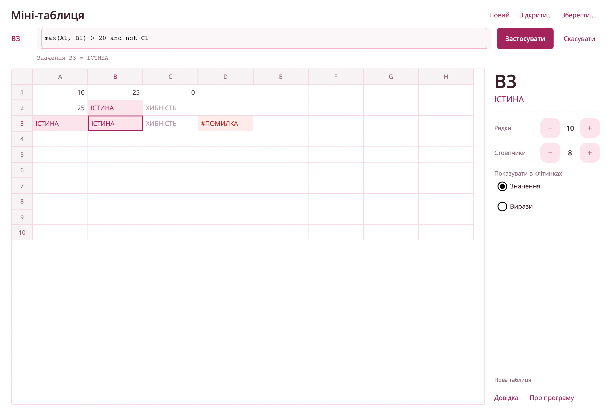

# Лабораторна робота №1: "Електронна таблиця"

##  Основний функціонал

* **Обчислення виразів:** Кожна клітинка містить логічний вираз, який обчислюється одразу після введення.
* **Посилання на комірки:** Вирази можуть включати посилання на інші комірки (напр., `max(A1, B1) > 10`).
* **Два етапи обробки:** Спочатку синтаксична перевірка з позначенням місця помилки, потім обчислення значення.
* **Два режими перегляду:**
    * **"Значення":** Показує обчислені результати (ІСТИНА / ХИБНІСТЬ або число).
    * **"Вирази":** Показує оригінальні введені вирази.
* **Керування таблицею:** Реалізовано додавання та видалення рядків і стовпчиків.
* **Збереження:** Таблицю можна зберегти у файл JSON і відкрити знову.
* **Помилки:** Виявляються циклічні посилання, посилання за межі таблиці та посилання на комірки з помилкою.

##  Реалізація (Варіант: операції 6, 8, 10, 11, 12)

Парсер виразів реалізовано власноруч методом **рекурсивного спуску** і підтримує операції:

* **Функції:** `max(x, y)` та `min(x, y)`
* **Порівняння:** `=`, `<`, `>`
* **Логічні:** `not`, `and`, `or`, `eqv`
* **Операнди:** цілі числа довільної довжини, посилання на комірки (`A1`, `B12`), `true` / `false`, круглі дужки

##  Використані технології

* **Мова:** C#
* **Платформа:** .NET MAUI (macOS, Windows)
* **Парсер:** власний (лексер → парсер → дерево виразу → обчислення)
* **Тести:** xUnit

